# Hi, I'm Taegun Park 👋

**Software Engineering student at Korea Aerospace University**  
Game Design · Level Design · Storytelling · Software Development

I like exploring why a game feels engaging—from the stories it tells to the choices players make and the spaces they move through. I turn those ideas into playable systems and working software.

게임의 즐거움을 이야기와 시스템, 플레이어의 선택과 동선에서 찾고, 이를 직접 기획하고 구현하고 있습니다.

## 🧭 About Me

- 🎮 **Game design:** I plan combat systems, narratives, and levels for indie action games.
- 🏈 **Currently building:** An American football management simulation focused on tactics, player development, and roster decisions.
- 🎬 **What inspires me:** Film, visual storytelling, strategy games, and the relationship between mechanics and player experience.
- 💻 **Beyond games:** I develop web applications, APIs, and data-driven tools.

## 🛠 Tech Stack

**Game Development & Design**

**Languages & Application Development**

**Data, Cloud & Tools**

## 🚀 Selected Projects

| Project | What it is | My contribution |
| :--- | :--- | :--- |
| **American Football Manager** *(in development)* | An American football management sim focused on tactics, roster decisions, and player growth. | Solo game design; designing player evaluation, progression, and season systems. |
| **[Project SilverBullet](https://wisetg.github.io/taegun-portfolio/)** *(in development)* | A 2D run-and-gun platformer built around evasive movement using enemy projectiles. | Lead narrative and level design; combat concept, stages, Unity tilemaps. |
| **[Titanomachia](https://wisetg.github.io/taegun-portfolio/)** | A six-person, mythology-inspired 2D Metroidvania action game. | Lead game planning, narrative direction, combat and level design. |
| **[FantasyDraft](https://github.com/wisetg/FantasyDraft)** | NFL fantasy analytics and trade comparison based on real league scoring rules. | Solo full-stack development; Sleeper API, 51 scoring categories, Spring Boot, React, AWS. |
| **[Paved Clouds](https://github.com/JinnyLyn/SoftBank-Hackathon)** | A managed-deployment concept for users unfamiliar with cloud infrastructure. | User-flow planning, backend APIs, database design, and worker/S3 integration. |
| **[Open-Ended AI Art](https://github.com/wisetg/Openended_AI_Art)** | Creative coding research involving EEG synchrony and evolving visual imagery. | Visualization design, JavaScript/Python experiments, and research co-authorship. |

## 🏅 Highlights

- **Excellence Award (Team)** — 4th Tetris Game-thon, Korea Aerospace University (Dec 2025), for *Titanomachia*.
- **Research co-author** — *Design of Open-Ended Biosignal Synchrony Art*, registered for IICCC 2026.

## 📊 GitHub Stats

  
  

  

Stats and language cards are generated daily by GitHub Actions. Language usage reflects repository code, not proficiency. The streak card is provided by a third-party service.

## 🔗 Find Me

